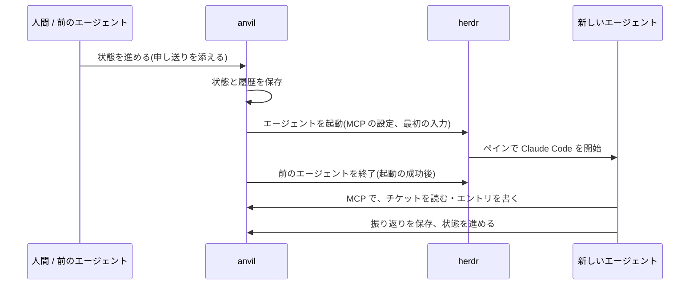

# エージェントのライフサイクル

エージェントは、チケットが**エージェントのいる状態**に入るたびに、anvil が起動する。作業が終わって次へ進めると、anvil が終了する。人間が操作して起動や終了をする場面は、ほとんどない。

状態の流れは [チケットのライフサイクル](ticket-lifecycle.md)。この文書は、その各状態でエージェントがどう動くかを説明する。

> **状態**: herdr での実起動は、実機で未検証(`herdr agent list` の読み取りだけ確認した)。以下は、コードの動作を説明したもので、実機で確認済みという意味ではない。実装は [`packages/usecase/src/agent/`](../packages/usecase/src/agent/) と [`packages/adapter/herdr-claude-cli/`](../packages/adapter/herdr-claude-cli/src/herdr-claude-cli.ts)。

## 1. 原則

- **1 つの状態に、1 つのロール**。エージェントは、そのロールの仕事だけをする。
- **チケットごと、ロールごとに別のエージェント**。1 つのエージェントを起動したまま、ロールを切り替えない。別のチケットへ移ることもない。
- **起動も終了も anvil が行う**。エージェントが自分で終わるのではなく、状態を進めると、anvil が終わらせる。
- **エージェントとの連絡は、チケット(エントリ)と MCP**。端末の画面は読まない。

## 2. 全体の流れ

## 3. 起動

チケットが、エージェントのいる状態に入ったとき(起票、状態の進行、差し戻し)に起動する。ゲート、TODO、完了には、エージェントがいない。この場合は、稼働中のエージェントを終了するだけ。

### 3.1 起動の手順

1. **名前を決める**: `anvil_t<チケット番号>_<ロール>`(herdr は、小文字・数字・`-`・`_` だけの 32 文字以内の名前しか受け付けない)。anvil からの送り込みは、この名前を持つエージェントにだけ届く。人間のペインには届かない。
2. **セッション ID を決める**: 新規なら新しい UUID。同じ状態の途中の**再開**なら、前の起動と同じ ID。
3. **最初の入力を作る**(§4)。
4. **起動の記録を保存する**(§6)。ここで失敗しても、記録は残る。
5. **MCP の設定を書く**(§5)。
6. **作業場所を決める**: ブランチを切った後は、ワークツリー。それまでは、対象リポジトリ。
7. **herdr で起動する**(§7)。
8. **成功したら、前のエージェントを終了する**。失敗したときは、前のエージェントを残す。

起動に失敗しても例外にはならず、**チケットに起動の失敗が記録される**。GUI に出るので、人間が見て、原因を直してから「着手」を押す。

### 3.2 新規と再開

| 場面 | 起動 |
|---|---|
| 状態が変わった(進行、差し戻し) | **新規**。前のセッションは引き継がない。差し戻しでも、前のエージェントは再開しない。戻した理由は、新しいエージェントがエントリから読む |
| 同じ状態の途中で、エージェントがいない | **再開**。同じセッション ID で `--resume` する。新しいエントリ(回答など)を読ませる |

## 4. 最初の入力

エージェントは、起動直後に次の内容を受け取る。

- 立場: チケット番号、タイトル、ロール、今の状態。
- **まず読むもの**: ロールの定義([agents/roles/](../agents/roles/))、プロジェクトコンテキストの入口と、そのロール用のページ。コーダーとレビュワーには、[コーディングの原則](../agents/coding-principles.md)も。ファイルは、パスだけを渡し、エージェントが自分で読む。
- チケットの種別、SP、デザインの要否、slug、対象リポジトリ、内容。
- **エントリ**: 総件数と、直近 3 件。全件は MCP(`anvil_read_entries`)で読める。
- 申し送り事項(前の状態から進めたときに添えられたもの)と、補足。
- **作業のルール**: 操作は MCP で行う。成果物と質問はエントリに書く。判断が欲しければ承認待ちフラグを立てる。終わったら振り返りを保存してから進める。問題があれば理由を添えて差し戻せる。

## 5. エージェントができること(MCP)

エージェントは、**MCP だけ**で anvil を操作する(CLI は使わない)。anvil は、起動のたびに**チケットとロールに結びついた MCP の設定**(`ANVIL_HOME/mcp/t<チケット>-<ロール>.json`)を書き、`claude --mcp-config` に渡す。結びついたエージェントは、自分のチケットを自分のロールとして操作する。

| ツール | 内容 |
|---|---|
| `anvil_read_ticket`、`anvil_read_entries` | チケットとエントリを読む |
| `anvil_add_entry` | エントリを書く(成果物、申し送り、質問など) |
| `anvil_ask` | 承認待ちフラグを立てて、人間の判断を待つ |
| `anvil_advance` | 次の状態へ進める(申し送りを添えられる) |
| `anvil_rollback` | 差し戻す(理由は必須) |
| `anvil_update_ticket`、`anvil_add_dependency` | チケットの更新、依存関係 |
| `anvil_board`、`anvil_create_ticket` | 一覧、起票 |
| `anvil_save_reflection` | 振り返りを保存する(§8) |
| `anvil_request_intake` | 分割・スパイクの起票を依頼する(AC 担当と実装方針担当だけ) |

人間が使う Claude は、結びつきなしで接続する(人間として振る舞い、`ticketId` を渡す)。ゲートの突破と承認待ちへの回答は、GUI で行う。

## 6. 起動の記録

anvil は、エージェントを起動するたびに**起動の記録**を残す。エントリを 1 件も書く前に止まっても、記録は残る。

| 項目 | 内容 |
|---|---|
| チケット、状態、ロール | どの仕事の起動か |
| 名前 | herdr 上の名前(送り込みの宛先) |
| セッション ID | 過去の会話の見直しと、再開に使う |
| 起動日時、終了日時 | 稼働中かどうかは、終了日時が空かで分かる |

終了の理由は持たない(状態の履歴から分かる)。過去の会話を読み取り専用で開く機能は、まだない(セッション ID の表示まで)。

## 7. herdr との連携

anvil は、**`herdr` コマンドを呼んで**操作する(ソケット API は使わない)。この部分は adapter に閉じ込めてあり、別の実行環境に差し替えられる。起動する実行環境は、`ANVIL_AGENT` で選ぶ(`herdr-claude-cli` か、何もしない `noop`。既定は `herdr-claude-cli`)。

| 操作 | herdr のコマンド |
|---|---|
| ワークスペース | プロジェクト名のワークスペースを探し、なければ `workspace create` |
| 置き場所 | チケットごとにタブ(`tab create --label T-<番号>`)。同じチケットのエージェントは同じタブに並ぶ |
| 起動 | `agent start <名前> --kind claude --pane <ペイン> -- --session-id <ID> --model <モデル> --mcp-config <設定>`(再開は `--resume <ID>`) |
| 最初の入力 | `agent prompt <名前> <入力>` |
| 送り込み | `agent prompt <名前> <文>` |
| 稼働の確認 | `agent list` に、その名前があるか |
| 終了 | `agent get` でペインを引き、`pane close` |
| 前面に出す | `agent focus` |
| 人間への通知 | `notification show`(承認待ち、着手可など。失敗しても処理は止めない) |

- **モデル**は、ロールごとの段階で決まる。多くは標準(Sonnet 5.5)、PR 作成担当だけ軽い段階(Haiku 5.5)。
- **人間は、GUI で該当のエージェントを見つけ、herdr でそのペインに会話しに行く**。GUI の操作で前面に出すこともできる。

## 8. 作業中

### 8.1 通常の進行

エージェントは、チケットとエントリを読み、仕事をし、成果物をエントリに書く。終わったら、次の順で呼ぶ。

1. **`anvil_save_reflection`**: 与えられた仕事と自分の成果を振り返る(良かった点、困った点、原因の仮説、改善案、改善の対象、根拠)。人間が定期的に一覧し、採用か却下かを決める。AI が、自分で指示を書き換えることはない。
2. **`anvil_advance`**: 次の状態へ進める。申し送り事項を添えられる。呼ぶと、anvil が次のエージェントを起動し、このエージェントを終了する。

振り返りがなくても、進めることはできる(強制しない)。

### 8.2 人間に聞く

判断が欲しいときは、`anvil_ask` で**承認待ちフラグ**を立てる。エージェントは**終了せず、起動したまま待つ**。

- 人間が GUI で回答すると、フラグが下りる。
- **エージェントが生きていれば**、anvil が回答を送り込む。**いなければ**(ペインが閉じられたなど)、同じセッションを**再開**して起動し、回答のエントリを読ませる。
- 依存先が未完了のとき、承認待ちフラグが立っているときは、自動では動かさない。

### 8.3 差し戻し

問題を見つけたら、`anvil_rollback` で、理由を添えて差し戻せる。戻り先は、指定がなければカテゴリ内の最初の状態。戻り先の状態に入ると、**新しいエージェント**が起動する(§3.2)。

## 9. 終了

| きっかけ | 動き |
|---|---|
| 状態を進めた、差し戻した | 次のエージェントの起動に**成功してから**、前のエージェントを終了する |
| ゲート、完了に入った | 稼働中のエージェントを終了する |
| 分割で元のチケットを破棄する | 起票の完了を待ってから、呼び出したエージェントを終了する |
| 承認待ちフラグ | 終了しない。待つ |

終了は、起動の記録に終了日時を入れ、herdr のペインを閉じる。ペインを閉じるのに失敗しても、記録は終わりとして扱う。**トークン切れへの特別な対応はない**。

## 10. 動かないとき

| 状況 | 見え方 | 対応 |
|---|---|---|
| 起動に失敗した | チケットに起動の失敗が出る | 原因を直して、GUI の**「着手」**を押す |
| 送り込みに失敗した | チケットに失敗が出る(人間が確認する) | herdr のペインを直接開いて、続きを伝える |
| エージェントが herdr から消えた | 稼働の確認で「いない」となり、着手前として扱われる | 「着手」を押すと、同じ状態なら再開する |
| herdr に接続できない | 稼働の確認は「不明」。anvil の記録を信じる | herdr を直す |

「着手」は、エージェントのいる状態で、承認待ちフラグがなく、依存先がすべて完了していて、エージェントが動いていないときだけ使える。動けるのに動いていないエージェントを動かすためのボタンで、それ以外の役割はない。

## 11. 特別なエージェント

- **PBI 起票担当**: チケットが未定のうちに動く。人間との会話で、やりたいことをタイトル・ペイン・ゲイン・AC に整えて起票する。起票されたチケットに、起動の記録を結びつける。
- **PR 作成担当**: herdr のペインを使わない**バックグラウンドのロール**。完了前ゲートに入ったとき、anvil が内部で動かして、PR の本文を作る。
